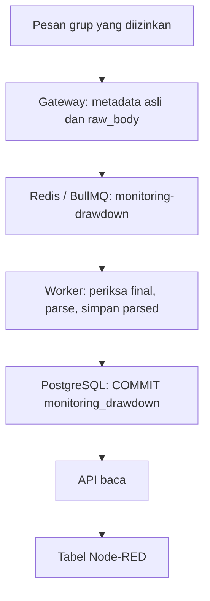

# Modul proyek bot WhatsApp

Dokumen ini menjelaskan source yang tersedia dan prosedur yang dijalankan pengguna. Penulisan modul tidak menjalankan tes, build, Docker, migrasi, pairing, backup, restore, atau Node-RED. Hasil yang disebut sebagai *harapan* bukan hasil pengujian. Pengguna mencatat bukti dan menetapkan penyelesaian sendiri.

## Urutan baca

| Modul | Dipakai ketika |
| --- | --- |
| [05 Lisensi](modules/05-licenses.md) | Dibaca sebelum setup/tes: Engine WSL tanpa Desktop, batas lisensi dependency/image, registry dan WhatsApp |
| [01 Setup](modules/01-setup.md) | Menyiapkan WSL, secret, store, jalur pesan manual, pairing, API, dan Node-RED |
| [02 Pengujian](modules/02-testing.md) | Menjalankan suite terisolasi dan skenario penerimaan, termasuk crash dan gangguan layanan |
| [03 Maintenance](modules/03-maintenance.md) | Memeriksa kapasitas, menangani failed job, restart, backup, restore, serta sesi dan credential |
| [04 Peta kode](modules/04-code-map.md) | Menemukan pemilik aturan, entrypoint, kontrak data, dan resource yang harus ditutup |

Semua contoh shell memakai Bash di WSL Ubuntu dengan direktori kerja `/mnt/e/bot-whatsapp-1`. Jangan menyalin sintaks Bash langsung ke PowerShell. Perintah di dalam blok adalah instruksi untuk operator, bukan rekaman eksekusi.

Jalur deployment memakai Docker Engine Community native di WSL, bukan Docker Desktop. Jangan menjalankan komponen yang belum disetujui IT/legal. Redis8, dependency LGPL dan browser/WhatsApp masih memerlukan penilaian yang dijelaskan pada modul lisensi; ketersediaan source bukan persetujuan penggunaan perusahaan.

## Alur dan batas data

Redis merupakan staging persisten, bukan cache yang boleh dibersihkan. PostgreSQL hanya menyimpan laporan final. Tidak ada endpoint HTTP ingest, staging SQL, atau antrean RAM cadangan. Bull Board untuk inspeksi; retry melalui command administrator dan hanya untuk native state `failed`.

Status bisnis `received`, `queued`, `accepted`, `invalid`, `failed` berbeda dari native state BullMQ `waiting`, `active`, `completed`, `failed`, `delayed`, `paused`. Pesan invalid dapat berada pada native state `completed`; itu tidak berarti diterima ke PostgreSQL.

Nomor WhatsApp khusus, izin anggota grup, akses host yang mendukung sandbox Chromium, dan akses instalasi Node-RED existing tetap diperlukan. Library WhatsApp tidak resmi; pengguna bertanggung jawab atas izin data dan risiko akun. Pesan yang gagal masuk Redis tidak dijanjikan akan diputar ulang oleh WhatsApp. AOF `everysec` juga bukan jaminan zero-loss.

## Tiga lingkungan yang jangan dicampur

1. **Suite otomatis** memakai profile `test`, `redis-test`, `db-test`, tmpfs, fixture credential, dan jaringan `test_private`. Tidak membutuhkan WhatsApp atau secret operasional.
2. **Lab manual** memakai project Compose baru, secret sendiri, volume sendiri, grup uji, dan port localhost yang tidak sedang dipakai. Lab dipakai untuk pairing, tampilan, restart AOF, kondisi penuh, dan backup/restore. Profile `test-ui` membaca API project tersebut; namanya tidak otomatis menjadikannya suite terisolasi.
3. **Operasional** baru dipakai setelah pengguna menilai hasil lab. Jangan mengarahkan tes crash, penghapusan job, atau simulasi memory penuh ke lingkungan ini.

Dilarang memakai `docker compose down -v`, TTL job, purge, atau pembersihan otomatis sebagai langkah pemulihan. Data pesan, dump, sesi WhatsApp, `.env`, dan secret tidak masuk Git atau laporan publik.

## Acuan

Kontrak produk terdapat di `../AGENT.md` relatif terhadap direktori `docs`, aturan kerja di `../AGENTS.md`. Nama perintah dan path modul mengikuti `package.json`, Compose, source `src/`, skrip `scripts/`, dan adapter `nodered/`. Jika pengguna mengubah konfigurasi, cocokkan lagi project, network, lokasi secret, dan nama volume sebelum menjalankan perintah mutatif.
